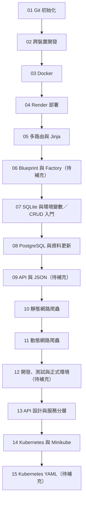

# 課程地圖

依下列順序閱讀與實作。第 13–15 課為後續延伸；標示「待補充」的教材目前尚無實作內容。

1. [Git 初始化與第一次上傳](/git/git_init.md)
2. [跨裝置接續開發](/git/git_continue_dev.md)
3. [Docker 環境與容器化](/containerization/docker.md)
4. [使用 Render 發佈網站](/launch/render.md)
5. [Flask 多路由與 Jinja 模板](/flask/muti_routes_and_Jinja.md)
6. [藍圖化與工廠模式](/flask/blueprint_and_factory.md)（待補充）
7. [SQLite 與環境變數（含 CRUD 入門）](/flask/SQLite_and_env.md)
8. [PostgreSQL 與 pgAdmin（更新待辦事項）](/flask/PostgreDB.md)
9. [API 與 JSON 資料](/flask/api_and_JSON.md)（待補充）
10. [靜態網路爬蟲](/flask/static_webcrawler.md)
11. [動態網路爬蟲](/flask/dynamic_webcrawler.md)
12. [開發、測試與正式環境](/flask/dev_test_and_prod.md)（待補充）
13. [API 設計與後端服務分層](/system_design/api_design.md)
14. [Kubernetes 與 Minikube](/containerization/k8s_n_chocolately.md)
15. [Kubernetes YAML 設定](/containerization/k8s_yaml.md)（待補充）



## 關於這份教材

這裡會整理出每次助教課的上課內容，如果同學沒有空來上課或者是想要複習、預習都可來這邊找找，基本上只要按照 markdown 檔案中的步驟往下做都不會有太大的問題，看不懂或者是出現自己沒辦法解決的問題可以私訊詢問助教(請不要害羞或是覺得會打擾助教，有看到並且有空一定會回)，助教會最大限度的幫助跟配合大家，如果覺得助教的教學方式哪裡有可以進步的地方一定要跟我說，在教學的同時我也學到很多收穫很多，教學相長，很感謝大家來上我的課，希望我的課能讓大家學到一點東西。

助教DC(從新增好友貼上以下名字)
```text
d3v1at10n
```

## 前言

大家好，我是這學期的助教。

在這門課裡，我和杰克會帶著大家從零開始，逐步建立屬於自己的網站專案。

我們的目標不只是完成課堂作業，而是實際打造一個可以部署到公網、真正對外公開的網站作品。
這個網站不會只是期末交完就結束的作業，而是一個可以持續擴充、無限 scale up 的專案。

如果時間允許，我們甚至可以把它進一步做成 Web App，讓你的網站不只是被瀏覽，而是可以像 App 一樣放在手機桌面上，成為真正可使用的產品。

在這個 AI 快速發展的時代，我認為比起單純記住語法，更重要的是——
能夠建立好自己的開發環境、看得懂自己真正需要的程式碼，還有培養清楚的設計思維。

現在 AI agent 很盛行，像是 Cursor、各種所謂的「vibe coding」工具都非常方便。
但我還是希望大家，在使用這些工具之前，能夠先自己動手試著理解問題、拆解問題、讀懂錯誤訊息，並嘗試剪接出真正適合自己專案的程式碼。

如果你真的花了一段時間，例如想了一個小時還是卡住，那再善用 AI agent 來幫助你，我覺得這會是一種更健康的學習方式。

工具可以幫助我們加速，但如果沒有理解基礎，我們很容易被工具帶著走。
我希望這學期大家不是「寫出程式」，而是真的「看得懂自己寫了什麼」。

我自己其實也還在學習的路上，不過或許可以帶大家避開一些我以前踩過的坑。
也很希望大家多和我討論問題，我相信我也能從你們身上學到不少新的觀點。

如果你們在學習過程中遇到困難，請不要猶豫來找我。我很期待和大家一起解決問題，一起成長。

也謝謝杰克給我這個機會，讓我能夠在這門課中持續學習與精進。

希望這學期我們都能做出讓自己驕傲且可以做為面試資本的作品。

## 教材使用方式

本專案整理網站開發課程的教材，涵蓋版本控制、容器化、Flask、資料庫、爬蟲、部署與系統設計。請依各篇教材的步驟操作，並確認每一步的結果再繼續。

- **建立檔案**：以 GitHub `TIP` 提示區塊獨立標出路徑與填寫方式。
- **程式碼與設定檔**：標示內容類型，並使用對應語言的程式碼區塊。
- **終端機指令、預期輸出與示意資料**：分別標註，避免將輸出或說明當成指令執行。
- **NOTE / IMPORTANT**：補充說明與必要操作。
- **WARNING / CAUTION**：敏感設定、環境限制或可能刪除資料的操作。
