[回到Readme](/Readme.md)



```mermaid
flowchart LR

subgraph LOCAL_SETUP[新裝置準備]
    A[git --version]
    B[建立資料夾]
    C[git clone repo]
    D[進入專案資料夾]
end

subgraph BRANCH_CHECK[分支檢查]
    E[git branch -a]
    F[確認目前所在分支]
end

subgraph GITHUB[GitHub 操作]
    G[建立新分支]
end

subgraph SYNC[同步遠端]
    H[git fetch]
    I[git pull]
end

subgraph SWITCH[切換分支]
    J[git switch -c branch origin/branch]
    K[再次檢查分支 git branch -a]
end

subgraph WORKFLOW[日常開發流程]
    L[修改檔案]
    M[git add .]
    N[git commit]
    O[git push]
end

A --> B --> C --> D
D --> E --> F
F --> G
G --> H --> I
I --> J --> K
K --> L --> M --> N --> O
```

# 在另一台裝置接續開發

如果我們需要在「另一個裝置」上繼續開發我們已經建立好、更新過的repo，可以使用以下操作接續開發

## 檢查是否安裝 & 檢查安裝版本

**終端機指令（Bash）**

```bash
git --version
```

## 在新裝置新增資料夾

這個資料夾是要放置複製下來的專案

所以等一下複製下來的下一層才是repo

以如下格式進行repo的克隆，把遠端的repo複製下來

git clone https://github.com/你的帳號/你的repo.git

**終端機指令（Bash）**

```bash
git clone
```

等待克隆完成，重新在VScode打開下一層你剛剛克隆好的 repo

接下來打開終端機輸入指令查看所有分支

**終端機指令（Bash）**

```bash
git branch -a
```

你會看到：
- '*' main
- remotes/origin/main
- remotes/origin/***

本地端應該是綠色且前面沒有 remotes 前綴

分支前方有 '*' 代表你現在所處的分支

> [!IMPORTANT]
> **開發前確認分支**
> 開始修改檔案前，先用 `git branch -a` 確認目前所在分支，避免將變更提交到錯誤的分支。

現在到倉庫主頁

點擊倉庫名稱下方的分支圖示的main

開啟選單之後再點選裡面的 View all branches

進入到查看所有分支的頁面後點選右上角的綠色 New branch 按鈕

輸入分支名字(可以是人名、版本、新功能或者是 bug 修復，基本上參考專案的大小跟合作的人數決定)

輸入好名字之後店選右下角的綠色 Create new branch 按鈕

建立好後應該會在 View all branches 頁面看到你剛剛建立的分支

通常會在開始開發功能前建立分支；若分支是在遠端新建，需先同步，再在本地建立追蹤分支。

之後回到本地的 VScode 在終端機輸入兩個更新倉庫的指令

**終端機指令（Bash）**

```bash
git fetch
```

**終端機指令（Bash）**

```bash
git pull
```

接著要切換到你上次所使用或者剛建立的分支

可以按照下面的格式在本地建立分支並追蹤遠端

前面是本地後面是遠端

git switch -c *** origin/***

**終端機指令（Bash）**

```bash
git switch -c 
```

最後檢查一下所有分支就可以繼續更新了

**終端機指令（Bash）**

```bash
git branch -a
```

最後我們在剛剛建立好的分支進行一次日常的更新

所謂日常的更新就是建立在這兩堂課所學的 git init & clone 之上

只有首次開啟專案 repo 跟在原 repo 接續開發會比較複雜

版本控制可記錄變更，並透過遠端倉庫與其他開發者協作。

接下來修改一下你的 README.md 然後存檔

日常更新三步驟(多用就會記起來)

把改過的檔案新增

**終端機指令（Bash）**

```bash
git add .
```

紀錄這次做了什麼事情(""裡的東西要自己認真的寫)

**終端機指令（Bash）**

```bash
git commit -m "Type what you did."
```

推送到遠端

**終端機指令（Bash）**

```bash
git push
```

這樣我們就學會了版本控制

> [!IMPORTANT]
> **更新前先同步**
> 開始日常開發前，先確認工作目錄狀態，再執行 `git fetch` 與 `git pull` 同步遠端變更，避免本地版本落後。

[回到Readme](/Readme.md)
